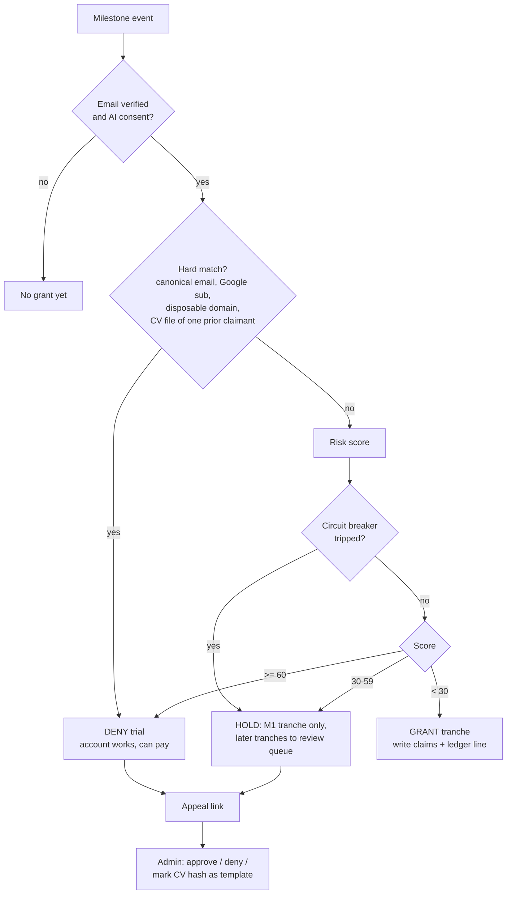

# 0042 — Trial credits and the duplicate-account gate

Status: Accepted (2026-10-11). Legal basis for retention after deletion still to be confirmed by counsel before the score is enforced.
Date: 2026-10-11
Supersedes: the recurring Free monthly grant in ADR 0036
Amends: ADR 0040 (one documented exception to "deletion erases everything")

## Context

Feedback after launch asked for free credits gated so that one person cannot farm them with many emails. Today:

- `CreditGrants.grantFreeIfDue` grants 300 credits per user per UTC month (`free:<userId>:<YYYY-MM>`), lazily from `DailyCapService` and daily from `BillingJobs.grantFree`.
- The grant is keyed on user id. `credit_ledger.user_id` is `ON DELETE CASCADE`, so **delete account, sign up again with the same email, get 300 more credits**. This is the most urgent hole.
- Email normalisation is only trim + lowercase (CITEXT). `a.b+x@gmail.com`, `ab@gmail.com` and `ab@googlemail.com` are three accounts.
- No disposable-domain check. IP rate limit is 5 signups/h per IP.
- Nigeria-first: ~99.8% of subscriptions are mobile, behind carrier-grade NAT. One IP is shared by hundreds to thousands of users, so IP is not an identity.

Owner decisions: staged one-time trial grant; email and CV checks, no phone verification; a duplicate identity can still sign up and pay, it only gets no trial credits.

## Decision

### 1. Credits: staged one-time trial instead of a monthly free grant

| Milestone | Event | Default tranche (config) |
|---|---|---|
| M1 email verified (or Google sign-in) | `identity.EmailVerified` (new, public) | 30 — covers the CV parse and one match run |
| M2 CV parsed | `profile.ResumeParsed` (new, public, carries userId) | 70 |
| M3 profile + preferences complete | `profile.OnboardingCompleted` (new) | 100 |
| M4 first matches viewed, on a different UTC day from M1 | `jobs`/`feed` writes `VIEWED` (already allowed by V20) and publishes `FirstMatchesViewed` | 100 |

- Amounts live in `app.billing.trial.tranches.*`. Decided 2026-10-11 from measured local costs (1 credit = $0.001): CV parse ≈ 10, one match-scoring run ≈ 9–13, a tailored CV ≈ 50–70, a cover letter ≈ 22. M1–M3 (200 credits) cover a parse, several match runs and one tailored CV with cover letter on day one; M4 is a reason to come back the next day.
- Total trial: 300 credits, about $0.30 of model cost per trial. Exposure per abused trial is small, so the design prefers low false positives (score in shadow mode first) over aggressive blocking.
- Ledger reason `TRIAL_GRANT` (new). Idempotency key `trial:<userId>:<milestone>`. The cross-account guarantee comes from §3, not from the key.
- Trial credits expire `app.billing.trial.validity` (default 30 days) after M1 via a `TRIAL_EXPIRY` line. `CreditLedgerStore.append` special-cases only `TOPUP`, so trial credits count as plan credit and the first paid grant expires any unspent trial balance. That is intended: no stacking of trial and paid allowance.
- During the trial the daily cap is `app.billing.trial.daily-cap-credits` (150: enough for match runs, one tailored CV and a cover letter in a day), lower than the paid cap of 500.
- Existing users keep their balance. The monthly free grant job is disabled by config (`app.billing.jobs.free-grant-enabled=false`), then removed in a later release. A seed migration writes claim rows (§3) for every existing verified user so current accounts cannot re-trial by deleting and re-signing.
- Global circuit breaker: if trial grants in the last hour exceed `app.billing.trial.hourly-ceiling`, new claims go to HOLD (§4).

### 2. Signals

| Signal | Class | Why |
|---|---|---|
| Canonical account email (§5) | HARD | Deterministic, ~zero false positives |
| Google `sub` (issuer + sub, never the Google email) | HARD | Google: unique, stable, never reused |
| Disposable email domain | HARD for the trial only | Account still works |
| CV file SHA-256 | HARD when it matches exactly one prior claimant; SOFT when seen on 3+ claimants (template) | Family/template CVs collide |
| CV contact email (LLM-parsed, canonical) | SOFT (+25) | Unverified: an attacker could upload a victim's email to burn the victim's trial |
| CV contact phone (E.164, default region NG) | SOFT (+30) | Same; shared family phones |
| Domain velocity (non-freemail domain with 3+ claims in 30 days) | SOFT (+15) | Catch-all custom domains |
| IP / ASN trial-claim velocity | VELOCITY only (+10 over threshold; datacenter ASN +10) | CGNAT makes IP reuse normal |
| Milestones M1→M3 in under 2 minutes | SOFT (+10) | Scripted |
| Google sign-in | −5 | Stronger account |
| CV email equals login email | −10 | Consistent person |

Deferred: fuzzy CV text fingerprint (simhash) and device fingerprint. Both are the best answer to "one person, many real Gmail accounts", but they need Hamming-distance lookup or client tracking, harder privacy justification and template suppression. Revisit after four weeks of shadow data (§7).

### 3. Claim store that survives deletion

```sql
-- V36__trial_identity_claims.sql
CREATE TABLE trial_identity_claims (
    id                 UUID        PRIMARY KEY DEFAULT gen_random_uuid(),
    kind               VARCHAR(16) NOT NULL CHECK (kind IN ('EMAIL','GOOGLE_SUB','CV_FILE','CV_EMAIL','CV_PHONE')),
    digest             BYTEA       NOT NULL CHECK (octet_length(digest) = 32),
    key_version        SMALLINT    NOT NULL,
    user_id            UUID        NULL REFERENCES users (id) ON DELETE SET NULL,
    claimed_milestones INTEGER     NOT NULL DEFAULT 0,
    first_claimed_at   TIMESTAMPTZ NOT NULL,
    last_seen_at       TIMESTAMPTZ NOT NULL,
    expires_at         TIMESTAMPTZ NOT NULL,
    CONSTRAINT trial_identity_claims_key UNIQUE (kind, digest, key_version)
);
CREATE INDEX trial_identity_claims_digest_idx  ON trial_identity_claims (digest);
CREATE INDEX trial_identity_claims_user_idx    ON trial_identity_claims (user_id) WHERE user_id IS NOT NULL;
CREATE INDEX trial_identity_claims_expires_idx ON trial_identity_claims (expires_at);
-- plus: credit_ledger_reason_check and credit_ledger_sign_check re-created with TRIAL_GRANT (>0) and TRIAL_EXPIRY (<0);
--       credit_ledger_key_check extended so both need an idempotency_key.
```

- `digest = HMAC-SHA-256(pepper[key_version], valueType || 0x1F || canonical)`. Value type (EMAIL, PHONE, GOOGLE_SUB, FILE) is the domain separator, not `kind`, so a CV email matches an account email.
- Plain SHA-256 of an email or a Nigerian phone number is reversible by dictionary in minutes; the pepper is what makes these pseudonymous. Peppers come from env/secret store (`TRIAL_PEPPER_V1`...), never the database, Flyway or the repo.
- Rotation: a keyring. Write with the current version, look up under every live version, re-key a row when it matches under an old one. Rotate yearly; retire a version once its last row expires. On a pepper leak together with a database exposure, delete that version's rows and accept a gap.
- Deletion: the billing `DeletionHandler` sets `user_id` to NULL (unlinking) instead of deleting the row. This is the one ADR 0040 exception: keyed hashes only, no raw values, no link to the person after deletion.
- Retention: 12 months after `last_seen_at`, renewed on each match, purged nightly by `compliance.RetentionTask`.
- Concurrency: in the grant transaction, compute all digests, sort them, take `pg_advisory_xact_lock` per digest, `SELECT ... FOR UPDATE` across all live key versions, decide, then upsert claims (`ON CONFLICT ... DO UPDATE SET claimed_milestones = claimed_milestones | :bit`) and append the ledger line. `ON CONFLICT DO NOTHING` alone cannot see cross-kind matches.
- Claims are written at claim time, so a later deletion cannot remove them.

### 4. Decision model



What the user sees:
- GRANT: "You've unlocked N credits."
- HOLD: "Your remaining trial credits are being confirmed, usually within 24 hours. You can keep going or upgrade now."
- DENY: "A free trial has already been used with these details. Your account works normally; buy credits to continue, or tell us if this is a mistake."
- Never say which signal matched. The gate runs only on verified signals and is rate limited, so it is not an oracle for "has this email used JobFinder".

The trial rule ("one free trial per person") is stated on the pricing page and in the terms.

### 5. Normalisation (for the claim key only, never for login)

| Provider | Strip `+tag` | Remove dots | Domain mapping |
|---|---|---|---|
| gmail.com, googlemail.com | yes | yes | googlemail.com → gmail.com |
| Google Workspace custom domains | yes | **no** | — |
| outlook / hotmail / live / msn | yes | no | do not merge hotmail with outlook |
| yahoo / ymail | yes | no | never strip after `-` |
| icloud / me / mac | yes | no | optional merge of the three |
| proton.me / protonmail.com / pm.me | yes | no | optional merge |
| fastmail | yes | no | `tag@user.fastmail.com` → `user@fastmail.com` |
| any other domain | yes | no | — |

Also: trim, Unicode NFKC, lowercase, domain to IDNA ASCII. Phone: libphonenumber, default region NG, `isValidNumber`, E.164, at most 3 numbers per CV. CV file: SHA-256 streamed at upload in `ResumeService.upload`, then HMAC'd; the file is never re-read.

Disposable domains: `disposable-email-domains/disposable-email-domains` (CC0) as the HARD list, refreshed weekly by a scheduled job that keeps the last good copy if the new file is empty or changes by more than 20%. Local allowlist and denylist override it. Match on the registrable domain.

### 6. Module wiring (Modulith-safe)

- identity publishes `EmailVerified(userId, canonicalEmailDigests, googleSubDigest)` from `verifyEmail` and `findOrLinkGoogleUser`. identity never calls billing.
- profile publishes `ResumeParsed(userId, resumeVersionId, fileDigest, cvEmailDigests, cvPhoneDigests)` from `ResumeParseStore.complete`, and `OnboardingCompleted(userId)` from preferences creation. Digests are computed where the raw value lives, so raw values never cross modules.
- The digester (`IdentityDigester`, `IdentityNormaliser`) lives in a small shared module both can use.
- billing owns `TrialGate` (listener on the three events), `trial_identity_claims`, and the `TRIAL_GRANT` ledger lines. `DailyCapService.status` exposes `trial: {state: GRANTED|HOLD|DENIED|PENDING, unlocked, remaining, expiresAt}`.
- admin gets `/admin/trials` (hold queue, appeal decisions, mark-as-template) and reuses `CreditAdjustments` for claw-backs.
- The IP passed into `EmailVerified` for velocity is a /24 (IPv4) or /48 (IPv6) bucket and the ASN only, held in Redis counters with a 24h TTL, never stored with the claim.

### 7. Rollout

1. Ship normalisation, disposable check, claim store, seed of existing users, and `TRIAL_GRANT` with the monthly free grant disabled. Hard rules enforce from day one; they close the delete-and-resignup and alias holes.
2. Run the score in shadow mode for 2–4 weeks: compute and log outcome only, grant as if GRANT.
3. Tune weights from shadow data and appeals, then enforce HOLD/DENY.
4. Decide on the fuzzy CV fingerprint with real numbers.

## Privacy and legal

- These digests are pseudonymised personal data, not anonymous (GDPR Recital 26, CJEU EDPS v SRB C-413/23 P, NDPA s.65), because we hold the pepper.
- Lawful basis: legitimate interest in fraud prevention (GDPR Art 6(1)(f), Recital 47; NDPA s.25(1)(b)(v)). The processing must be disclosed upfront, or NDPA s.25(2)(c) removes the basis.
- Privacy policy, section 2, new row: *Trial-eligibility fingerprints — keyed one-way hashes (HMAC-SHA-256) of your account email, Google account identifier, uploaded CV file, and any email address or phone number in your CV, so that each person receives free trial credits once, including if an account is deleted and re-created. Basis: our legitimate interest in preventing fraud and abuse. We cannot read the original values back from these hashes.*
- Privacy policy, section 7, new bullet: *Trial-eligibility fingerprints: 12 months after they were last used to check trial eligibility. When you delete your account they are disconnected from it and everything else is erased, but they are kept until that period ends so free trial credits cannot be claimed again.*
- Export: while the account exists, the export lists the claim kinds, dates and expiry. After deletion, a person who gives their email or phone can have the rows found by recomputing the digest (GDPR Art 11(2)).
- Erasure requests for these rows: refuse case by case on overriding legitimate grounds (GDPR Art 17(1)(c) with Art 21(1); NDPA s.34(2), s.36(2)), not Art 17(3), which does not cover fraud prevention. **Nigerian and EU/UK counsel must confirm before launch**, together with the placeholders already open on the live policy.
- Logs never contain a digest together with a user id, email or IP.

## Consequences

- Closes delete-and-resignup and alias farming deterministically.
- One person with several genuine Gmail accounts and several different CVs still gets several trials until the fuzzy fingerprint lands. The tranche sizes, the day gap before M4, the trial daily cap and expiry bound the cost of each.
- Adds a deliberate retention exception that must be disclosed and reviewed.
- Losing the pepper means losing the gate's memory; leaking it with a database dump is a reportable breach (GDPR Art 33, NDPA s.40).
- Free users no longer get a monthly allowance. If a recurring free tier is wanted later, it becomes a tiny monthly grant keyed per claim identity, not per user id.
