# 0043 — Design system: tokens, type and component rules

Status: Accepted
Date: 2026-10-11
Scope: G4 Part 1 (tokens, shared marketing/auth shell, landing and auth pages). Part 2 restyles the in-app screens on the same tokens.

## Context

The web app still runs on the stock shadcn/ui neutral theme: grey on white, Geist, no identity. Feedback after launch asked for a
cleaner, more modern look. Who we design for decides most of the choices below:

- Job seekers in Nigeria first, everywhere else second.
- Mostly mid-range Android phones on metered mobile data, often outdoors or in bright light.
- People under pressure, scanning many jobs quickly. The match score (0–100) is the product's signature moment.

So: legibility and contrast before decoration, fast first paint, no hero photography, one font file family at most, and a
colour system that gives the match score a clear, honest scale.

## Decision

### Character

Calm, practical, quietly optimistic. A deep **forest green** carries the brand (growth, "go", and a nod to home without
flag-waving); **marigold** is the single warm highlight, reserved for things worth noticing. Surfaces are cool green-tinted
whites in light mode and green-black in dark mode, never pure grey. Layouts are left-aligned and read top to bottom on a phone.

### Token layers

```mermaid
flowchart LR
  subgraph P[Primitives]
    G[green 50..900]
    M[marigold 100..700]
    N[neutral 0..950]
    R[red 100..600]
  end
  subgraph S[Semantic tokens]
    BG[background / foreground / card]
    MU[muted / muted-foreground]
    PR[primary / ring]
    AC[accent / highlight]
    ST[success / warning / destructive]
    BO[border / input]
    SC[score-low / fair / strong / top]
  end
  subgraph C[Components]
    BT[Button]
    IN[Input / Textarea]
    CA[Card]
    BA[Badge]
    SS[Site shell]
    SM[Score meter]
  end
  P --> S --> C
```

- **Primitives** (`--jf-*` in `globals.css`) are raw hex values. Nothing outside `globals.css` references them.
- **Semantic tokens** (`--background`, `--primary`, …) map primitives per theme. Components and pages use only these, through
  Tailwind utilities (`bg-primary`, `text-muted-foreground`, `text-score-strong`).
- **Components** (shadcn/ui primitives in `src/components/ui`, the site shell, the score meter) combine semantic tokens.
  Pages compose components and never set raw colours.

### Palette

Primitives:

| Ramp | Values |
|---|---|
| green | 50 `#EAF4F0`, 100 `#CFE6DD`, 300 `#9BE6CC`, 400 `#5CCFAE`, 600 `#13755F`, 700 `#0F5C4D`, 800 `#0B463B`, 900 `#062019` |
| marigold | 100 `#FDF0D3`, 200 `#FBE7B5`, 400 `#F2B33D`, 600 `#94650A`, 700 `#8A5A06`, 900 `#3A2D0D` |
| neutral (green-grey) | 0 `#FFFFFF`, 25 `#F6F8F7`, 50 `#EEF2F0`, 100 `#E1E7E4`, 150 `#D9E1DD`, 300 `#A3B1AB`, 400 `#8A9893`, 450 `#7F8D88`, 500 `#66756F`, 550 `#5E6D67`, 600 `#4D5B56`, 800 `#26332E`, 850 `#1A2622`, 900 `#131D1A`, 950 `#0D1513`, ink `#13231E`, mist `#E8EFEC` |
| red | 100 `#FBE4E1`, 400 `#F07A6E`, 600 `#B02E24`, 950 `#1A0B09` |

Semantic tokens (contrast ratios are WCAG 2.x, measured against the surface they sit on):

| Token | Light | Dark | Notes |
|---|---|---|---|
| background | `#F6F8F7` | `#0D1513` | page |
| foreground | `#13231E` (15.3:1) | `#E8EFEC` (15.9:1) | body text |
| card / popover | `#FFFFFF` | `#131D1A` / `#1A2622` | raised surfaces |
| muted | `#EEF2F0` | `#1A2622` | quiet fills |
| muted-foreground | `#4D5B56` (6.7:1) | `#A3B1AB` (8.3:1) | secondary text, still AA |
| primary | `#0F5C4D` | `#5CCFAE` | actions, links |
| primary-foreground | `#FFFFFF` (7.9:1) | `#062019` (9.0:1) | text on primary |
| accent | `#FDF0D3` | `#3A2D0D` | soft marigold tint: hover, selected rows |
| accent-foreground | `#13231E` (14.4:1) | `#FBE7B5` (11.0:1) | |
| highlight | `#F2B33D` | `#F2B33D` | strong marigold fill, always with ink text (8.8:1) |
| success | `#13755F` (5.6:1) | `#6FD59B` (9.6:1) | |
| warning | `#94650A` (5.1:1) | `#F2B33D` (9.3:1) | text colour; fills use `highlight` |
| destructive | `#B02E24` | `#F07A6E` (6.3:1) | errors, delete |
| border | `#D9E1DD` | `#26332E` | decorative dividers |
| input | `#7F8D88` (3.5:1) | `#5E6D67` (3.2:1) | form control borders meet the 3:1 non-text rule |
| ring | `#0F5C4D` | `#5CCFAE` | focus outline |

Match-score scale. The number is always shown as text ("82/100"); colour only reinforces it. Four bands, matching the
thresholds the feed already uses:

| Band | Range | Light | Dark |
|---|---|---|---|
| score-low | 0–49 | `#66756F` (4.8:1) | `#8A9893` (5.7:1) |
| score-fair | 50–74 | `#94650A` (5.1:1) | `#F2B33D` (9.3:1) |
| score-strong | 75–89 | `#13755F` (5.6:1) | `#5CCFAE` (9.0:1) |
| score-top | 90–100 | `#0B463B` (10.8:1) | `#9BE6CC` (12.0:1) |

`scoreBand(score)` in `src/lib/score-scale.ts` is the only place the thresholds live. Bands are named, not coloured, so a
"low" score is grey, not red: a low match is information, not an error.

Dark mode follows the operating system (`prefers-color-scheme`); a `.dark` or `.light` class on `<html>` overrides it,
ready for a theme switch later.

### Type

One self-hosted variable font: **Bricolage Grotesque** via `next/font/google` (downloaded at build time and served from our
own origin; no runtime dependency, no request to Google from the browser). Its optical-size axis keeps body text calm and
lets headings tighten into a confident, slightly condensed grotesque, so one family covers both roles. Latin subset only;
`font-display: swap` so text paints immediately in the system fallback. Monospace uses the system stack.

Scale: major third (1.25) on a 16 px base, sentence case throughout.

| Step | Size / line height | Use |
|---|---|---|
| xs | 12 / 16 | legal links, captions |
| sm | 14 / 20 | secondary text, labels |
| base | 16 / 24 | body (inputs are 16 px on phones so Android does not zoom) |
| lg | 20 / 28 | lead paragraphs, card titles |
| xl | 25 / 32 | section headings, auth page titles |
| 2xl | 31 / 36 | landing section titles |
| display | clamp(2.25rem, 6vw + 1rem, 3.9rem) / 1.05 | landing hero only |

Weights: 400 body, 500 labels and buttons, 650 headings, 750 display. Headings use tight tracking (−0.02em); body uses
the default. Lines stay under about 70 characters (`max-w-prose` or narrower). Numbers in scores and prices use
`tabular-nums`.

### Spacing, layout

Tailwind's 4 px grid (`--spacing: 0.25rem`). Rhythm: 4/8/12 inside components, 16/24 between related blocks,
48/64/96 between page sections. Page gutters are 16 px on phones, 24 px from `sm`. Content width 72 rem for marketing pages,
28 rem for auth forms. Touch targets are at least 44 px tall for primary actions (buttons `lg`, inputs `h-11`).

### Radius

Radius follows hierarchy rather than one value everywhere: `--radius: 0.625rem` (10 px).

- Controls (buttons, inputs): `rounded-lg` = 10 px.
- Cards and panels: `rounded-2xl` ≈ 18 px.
- Badges and score chips: `rounded-full`.
- Tiny items (checkbox, skip link): `rounded-sm`.

### Elevation

Flat by default. Three levels, shadows tinted with the ink hue, never pure black:

- `shadow-xs`: inputs and outline buttons (barely there).
- `shadow-sm`: cards that sit on the page background.
- `shadow-lg`: popovers, menus, the landing example card.

In dark mode shadows are nearly invisible, so elevation comes from the lighter surface (`card` and `popover`) plus a 1 px
border.

### Motion

Motion explains a change; it does not decorate. Durations: 120 ms for hover and press, 200 ms for opening and closing,
standard easing `cubic-bezier(0.2, 0, 0, 1)`. No looping or entrance animations on page load. Everything is disabled
under `prefers-reduced-motion: reduce` (a global rule in `globals.css`).

### Component rules

- **Buttons.** One primary button per view. Primary: solid `primary`. Secondary actions: `outline`. Tertiary and nav:
  `ghost` or `link`. Labels say what happens ("Create account", "Sign in"), no trailing arrows. Disabled uses 50 % opacity and
  keeps its label; pending states change the label ("Signing in…").
- **Inputs.** 44 px tall (`h-11`) with a 3:1 `input` border on `card`. Label above, always visible; hints below in
  `muted-foreground`, linked with `aria-describedby`. Errors use `destructive` text plus `aria-invalid`, never colour alone.
- **Cards.** Use for a real grouped object (a job, a form, an example match), not to chop prose into tiles. `card` surface,
  `border`, `rounded-2xl`, `shadow-sm` in light mode.
- **Badges.** Pills for short status words. Never the only carrier of meaning; the text says it.
- **Focus.** Every interactive element shows a 2 px `ring` outline with a 2 px offset on `:focus-visible`. Never remove it
  without a replacement.
- **Links.** Inline links are `primary` and underlined; nav links are not underlined but get the focus ring.
- **Shell.** Marketing and auth pages share `SiteHeader` and `SiteFooter` (`src/components/layout/site-shell.tsx`). The
  header has a nav slot for public links (G3 adds "Pricing"), then "Sign in" and "Sign up".

### Do and don't

| Do | Don't |
|---|---|
| Show the score as a number first, colour second | Use red for a low match |
| Use `highlight` (marigold) once per screen, for the thing worth noticing | Paint headings, borders and icons marigold |
| Keep copy factual: what the product does today | Invent stats, testimonials, user counts or company logos |
| Use semantic tokens through Tailwind utilities | Write hex values or `emerald-600`-style palette classes in components |
| Left-align text; one column on phones | Centre long paragraphs or use multi-column body text |
| Use system-drawn shapes and icons (lucide) | Add photos, illustrations or background video to marketing pages |
| Respect `prefers-reduced-motion` | Animate sections into view on scroll |

## Consequences

- Every screen picks up the new palette and font as soon as this merges, because existing components already use the
  shadcn token names. In-app screens still contain a few palette classes (`emerald-*`, `amber-*` in the score badge, admin
  badges, interview feedback, legal draft banner); Part 2 replaces them with the score and status tokens.
- Dark mode becomes reachable for the first time (it follows the OS). Screens already carry `dark:` variants; Part 2 checks
  each one.
- No new runtime dependency. The font is fetched at build time, exactly as Geist was, and replaces both Geist families.
