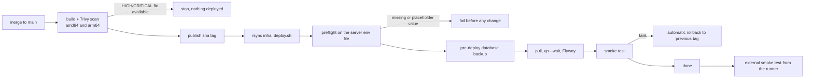

# 0045 — Automatic production deploys from main

Status: Accepted (2026-10-12)
Amends: ADR 0041 (production deploys only on a tag with a reviewer's approval)

## Context

The only server is one OCI Ampere A1 VM (`/opt/jobfinder`, run by the `deploy` user). ADR 0041 planned staging on `main` and production on a `v*` tag behind a required reviewer. There is no separate staging host, the `staging` and `production` GitHub environments were never created, and deploys have been run by hand. The owner wants every merge to `main` to reach production without manual steps.

## Decision

- A push to `main` publishes `sha-<commit>` images (build, Trivy scan, multi-arch manifest, unchanged) and, when the repository variable `AUTO_DEPLOY_PRODUCTION` is `true`, deploys that tag to the `production` environment through the existing `ssh-deploy` action.
- The `production` GitHub environment has no required reviewers; its secrets are `DEPLOY_HOST`, `DEPLOY_USER` (`deploy`), `DEPLOY_SSH_KEY` (a key used only by this pipeline), `DEPLOY_KNOWN_HOSTS` (pinned, verified against the host key), optionally `SMOKE_USER_EMAIL` and `SMOKE_USER_PASSWORD`; variable `SITE_ADDRESS`.
- Tag pushes keep working as before, and `workflow_dispatch` is how a release is rolled back to an older tag.
- Pushes that only touch `docs/**` or `*.md` do not run the pipeline.
- Turning it off is deleting or changing the variable; nothing else needs to change.

## Safety net

- Concurrency group `deploy-production` serialises deploys; a second push waits.
- Code reaches `main` only through pull requests whose CI (maven, npm, python, static, secrets, images) must pass; branch protection should require those checks.
- Migrations must stay backward compatible (CLAUDE.md), because the previous release must run against the migrated schema during a rollback.

## Consequences

- Every merged change is live within the pipeline's run time (build is the long part), so review before merging matters more than before. A UI or behaviour change that needs a look first should be held on a branch, or `AUTO_DEPLOY_PRODUCTION` set to something else for a while.
- Rollback after a successful but wrong deploy: run `deploy` with `workflow_dispatch` for the previous tag (`.deploy-state/previous_tag` on the server shows it).
- The single VM remains a single point of failure (ADR 0041).
