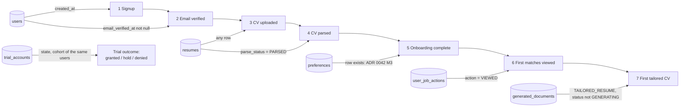

# 0046 — Activation funnel and trial progress

Status: Accepted (2026-10-12)
Date: 2026-10-12
Builds on: ADR 0042 (trial gate and milestones M1–M4), ADR 0040 (account data), ADR 0043 (design tokens)

## Context

Phase G needs the signup-to-activation funnel visible per step, and the user needs to see how far through the trial
credits they are. ADR 0042 already made the four trial milestones into events (`activation.*`) and records what they
unlocked (`trial_accounts`). The funnel has three more steps than the trial: signup, CV uploaded and first tailored CV.

## Decision

### 1. Derive every step from the table that already records it

No step lacks a record, so **no new table and no migration** (V39 stays free). An append-only `activation_events` table
would duplicate facts that users, resumes, preferences, `user_job_actions` and `generated_documents` already hold, and it
would be one more place to keep in step with account deletion (ADR 0040).

- **Cohort.** The users whose `created_at` falls in the requested UTC date range (default: the last 30 days, today
  included), minus admins. Each user is counted once per step, in the week of their signup (UTC, Monday start).
- **Strict funnel.** A user counts at step *n* only if they also reached every step before it. Conversion is then never
  above 100% and the step-to-step rate is `count(n) / count(n-1)`; the overall rate is `count(n) / count(signup)`. A rate
  with a zero denominator is null, not 0.
- **Why a table scan and not events.** The counts are an admin report over a bounded range, run on demand. They read
  other modules' tables through plain SQL in one read-only query, owned by the `activation` module. No module injects
  another module's repository, and `activation` still depends on no other module.
- **Timing.** Only whether a step was ever reached matters, not when, so the odd timestamp (a resume's `updated_at`) is
  not used.
- **Deletion.** The report is computed from live rows, so a deleted account leaves the funnel at once, with nothing to
  erase and nothing retained. Funnel counts are not a retention exception to ADR 0040.
- **M4 differs on purpose.** The trial grants M4 only on a later UTC day than M1; the funnel step "first matches viewed"
  is any `VIEWED` row, so the two can differ for a user who looked on day one.

### 2. Trial outcomes

Granted / hold / denied counts come from `trial_accounts` for the same cohort. They are aggregates: no identity, risk
score or signal is returned. Accounts that existed before the trial (`LEGACY`) are not part of it. Billing owns the
table, so billing exposes the count (`TrialOutcomeReports`) and the admin controller combines the two reports.

### 3. Endpoint

`GET /admin/activation?from=yyyy-MM-dd&to=yyyy-MM-dd` (ROLE_ADMIN through the existing `/admin/**` rule; 401 without a
token, 403 for a user). 400 `invalid_range` when `to` is before `from` or the range exceeds 366 days. The response
carries `steps` (count, step-to-step and overall conversion), `cohorts` (the same counts per signup week) and `trial`.
No row identifies a user.

### 4. Credit progress for the user

`GET /billing/me` already carries `trial` (state, unlocked, remaining, expiry, milestones reached). It gains `tranches`:
the four milestones in order with the credits each releases from configuration and whether it is unlocked. The web
stepper renders only what the API reports:

- GRANTED: the four milestones, which are unlocked, the credits each releases, the total unlocked and the total on offer.
- PENDING: the same list, none unlocked; the copy says what each step releases, "once your email is verified".
- HOLD: the unlocked part and the API's own wording that the rest is being confirmed. Locked tranches are not promised.
- DENIED: a neutral line that no trial credits were added; no list of upcoming credits and never which signal matched.
- No trial (`null`, accounts from before the trial): the indicator is not rendered.

The onboarding screens are not restyled here (G4 part 2).

## Consequences

- The funnel costs nothing to write and cannot drift from the facts it counts.
- A report over a long range scans `users` in that range and probes the other tables by user id; at the current size
  this is cheap. If it ever is not, a nightly summary table is the next step, and it would need its own deletion story.
- Counts for a past cohort change if users delete their account or a resume is deleted; the funnel is a live view, not an
  audit trail.
