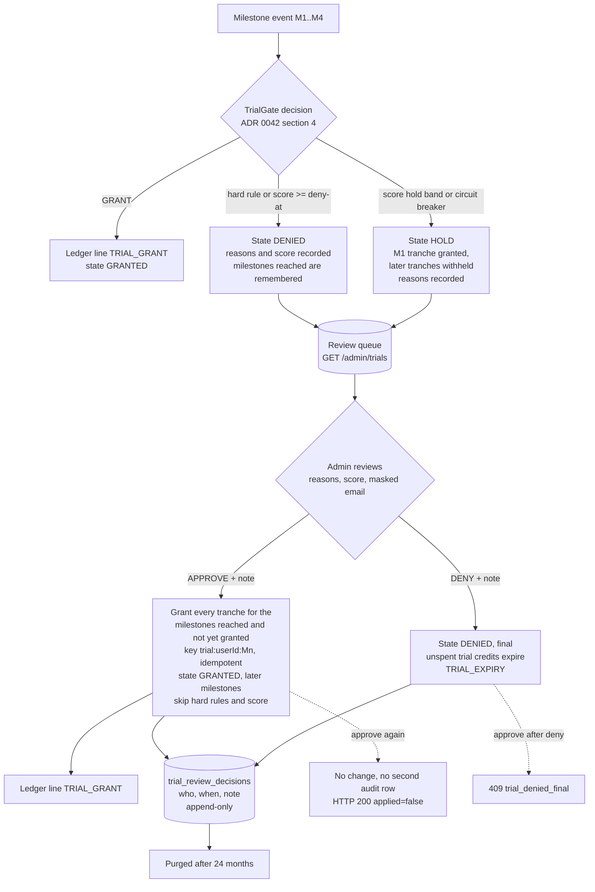

# 0047 — Trial review queue (`/admin/trials`)

Status: Accepted (2026-10-13)
Date: 2026-10-13
Amends: ADR 0042 (§4 "Admin: approve / deny", §6 "admin gets `/admin/trials`"; implementation notes: "The review queue and
appeals are not part of G1")

## Context

ADR 0042 runs the duplicate-account gate in two stages: hard rules enforce from day one, the risk score runs in shadow
mode (`app.billing.trial.score-enforced=false`) until tuned. A hard rule can still be wrong (a shared family phone is not
a hard rule, but a CV file that one relative uploaded first, or a reused corporate catch-all address, can be), and once the
score is enforced, HOLD and DENIED will also contain real people. Today those accounts have nowhere to go: the decision is
only in a log line and the `trial_accounts.state` column. Before enforcement is ever switched on, an admin needs to see who
is held or denied and why, and to correct a false positive or make a denial final.

This ADR changes none of the gate's rules, weights or thresholds, and does not touch `score-enforced`.

## Decision

### 1. Process

The gate decides as before. HOLD and DENIED accounts become reviewable. An admin approves (the staged grant is released
through the existing ledger path) or denies (final). Every decision is written to an append-only audit table.

### 2. What the queue lists and shows

- `GET /admin/trials` lists accounts whose state is HOLD or DENIED and that no admin has decided yet (view `PENDING`, the
  default), or accounts an admin has decided (view `DECIDED`). Filters: `state` (HOLD, DENIED, GRANTED) and `view`.
  Pagination is page/size (CLAUDE.md, admin lists), oldest first: by the time the gate first recorded the account
  (`trial_accounts.created_at`), then user id as a stable tie-break.
- Each item shows only: account id, masked email (`s***@gmail.com`: first character of the local part and the full domain,
  because the domain explains `disposable-domain`), signup date, state, review status, risk score, the reasons (code, points,
  hard or soft), milestones reached and granted, the trial expiry, and for a decided account when it was decided.
- Never returned or stored for the queue: digests, the pepper, claim rows, CV content, IP buckets, full email addresses, phone
  numbers, other accounts that matched. The reason code says which rule fired (`account-email`, `cv-file`, ...), not which
  other account it matched.
- Reasons are the gate's own signal names and points from ADR 0042 §2/§4: hard rules `account-email`, `google-account`,
  `disposable-domain`, `cv-file`; soft signals `cv-file-shared`, `cv-email`, `cv-email-is-account-email`, `cv-phone`,
  `google-sign-in`, `fast-onboarding`; and `hourly-ceiling` (circuit breaker), `no-claim-key`. They are persisted on
  `trial_accounts.decision_reasons` (codes and points only). Accounts decided before this change have no recorded reasons
  and the page says so.

### 3. Actions

| Action | Allowed when | Effect | Replay |
|---|---|---|---|
| APPROVE | state HOLD or DENIED, not decided by an admin, trial not ended | state GRANTED. Every tranche for a milestone the account reached and has not been granted is appended as `TRIAL_GRANT` with the gate's own key `trial:<userId>:<Mn>`, so a repeat or a race with the gate cannot grant twice. A DENIED account without an expiry gets `now + app.billing.trial.validity`. Later milestones skip the hard rules and the score (the admin has overruled them) and are granted | already approved: 200, `applied=false`, nothing written |
| DENY | state HOLD or DENIED, not approved | state DENIED, final: approve afterwards is 409 `trial_denied_final`. A HOLD trial's unspent trial credits expire (`TRIAL_EXPIRY`, the same key and rules as the 30-day expiry); credits already spent stay spent. A claw-back of anything else is a separate `CreditAdjustments` call | already denied: 200, `applied=false` |

Both need a free-text note of 1 to 1000 characters (blank is 400). The note is for the reason for the decision, not for
personal data.

The user's view does not change: `GET /billing/me` already shows `trial.state` and never why. No message is sent to the user
by this change.

### 4. Audit

`trial_review_decisions` (Flyway V39): id, user id, admin id, action, state before, note, credits granted, decided at.
Append-only, enforced in the database by a trigger: UPDATE and TRUNCATE are always refused, DELETE is refused for rows
younger than 730 days. A decision and its ledger lines are written in one transaction under the user's ledger lock, which
the gate also takes, so a decision is never audited without its effect or the reverse. User id and admin id are plain UUID
columns without foreign keys: deleting either account must not rewrite the audit trail.

### 5. Privacy and retention

- Data minimisation: the queue returns a masked email only; the audit table holds ids, the action, the note and a credit
  count. No raw email, hash, phone, IP or CV content is added anywhere.
- Admin notes are free text and can mention a person despite the instruction. Retention: 24 months after the decision, purged
  nightly by `compliance.RetentionTask` (`trial-review-decisions`, `app.billing.trial.review-retention`, default `P730D`; the
  database refuses to delete younger rows, so a shorter setting does nothing). Reason: the same legitimate interest as the claims
  in ADR 0042 (fraud prevention, defending a decision the person disputes), but kept longer than the claims' 12 months so that a
  late complaint can still be answered. This is a deliberate, disclosed exception to "deletion erases everything" (ADR 0040):
  when a user deletes the account, `trial_accounts` (state, reasons, reached milestones) is erased as before, but the
  audit rows stay until the purge. They hold a user id that no longer points to anything and no email.
- The privacy policy section 7 bullet from ADR 0042 needs one more sentence: *Trial review decisions (the decision, the date and
  an administrator's note): 24 months after the decision.* Counsel confirms this together with the open points in ADR 0042
  before the score is enforced.
- Export: while the account exists, the data export does not list review decisions (they concern the service's own fraud
  controls, not the user's content), consistent with the claims; the person can ask, and the rows are found by user id.
- Logs: the controller logs admin id, user id and action, never the note.

### 6. Rollout and safety

- Authorisation: `/admin/**` is ADMIN-only in `SecurityConfig`; the existing `AdminAndInternalAccessGuardTests` covers the new
  endpoints automatically (401 anonymous, 403 user).
- In shadow mode (today) HOLD does not occur and DENIED comes only from hard rules, so the queue starts with the hard-rule
  denials. The same code serves HOLD once the score is enforced.
- Milestones reached after an account was denied could not be recovered before this change: the gate dropped them. From now
  on the gate remembers them (`trial_accounts.milestones_reached`). For accounts denied earlier, only M1 is known, so an
  approval grants M1 and later milestones unlock as the user reaches them again.

## Not decided here: appeals (follow-up)

ADR 0042 §4 shows an "Appeal link" in the decision diagram and the DENY message says "tell us if this is a mistake", and §6 says
the admin handles "appeal decisions". It defines no mechanism: no endpoint, no form, no data (what an appellant may send, who
may appeal, how an appeal is tied to an account without leaking the matched signal, rate limits, retention of what they write).
Inventing that here would also add an unauthenticated or semi-authenticated write path to the trial gate, which ADR 0042 §4
avoids on purpose ("not an oracle"). So this change does **not** record or surface appeals. The queue is reachable only through
the gate's own decisions. Follow-up, before enforcing the score: an ADR for the appeal path (signed-in user only, one open
appeal per account, free-text of bounded length, shown as an extra column in this queue, appeal text retained like the admin
note). Until then the only route is that a user writes to support, and an admin finds the account in the queue by its
masked email and signup date.

## Consequences

- False positives from the hard rules can be corrected and the work of correcting them is auditable.
- The gate now records reasons and reached milestones on every decision (a few bytes per account); decision logic is unchanged.
- An approved account is exempt from the gate's checks for its remaining milestones. That is intended: the admin already
  looked at the evidence.
- A reviewer sees the domain of the email. That is more than the digests-only rule of ADR 0042 for the claim store, but it is the
  admin's own console, behind the ADMIN role, and the local part of the address is never shown beyond its first character.
- Appeals remain open until the follow-up ADR.
